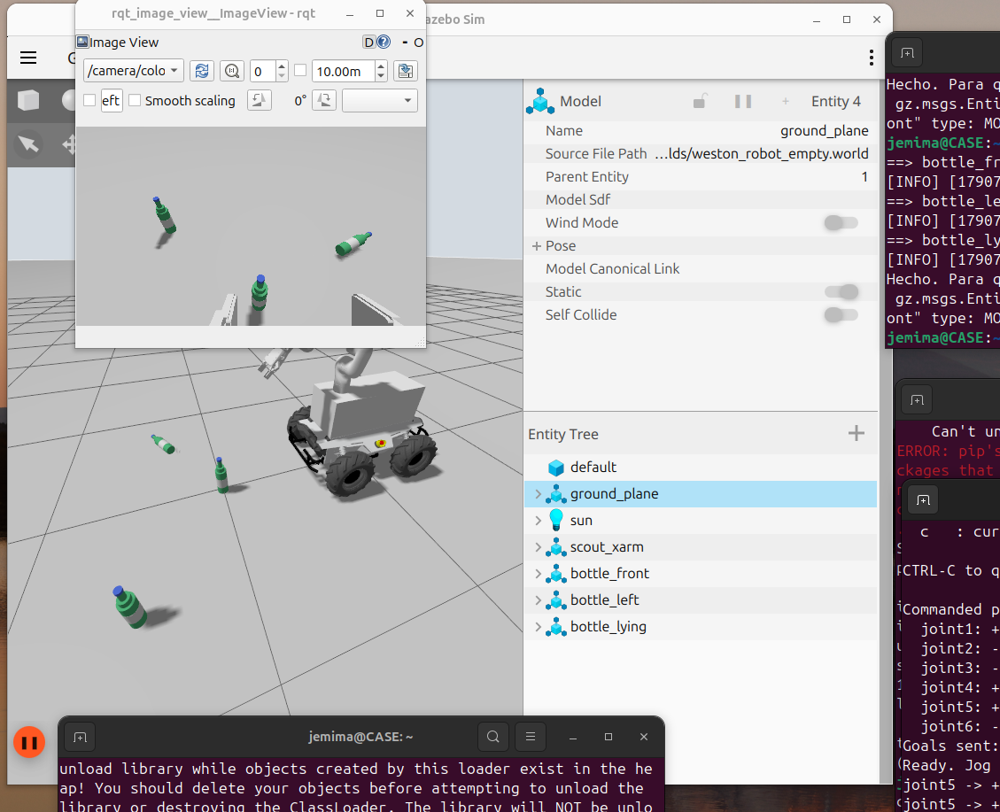
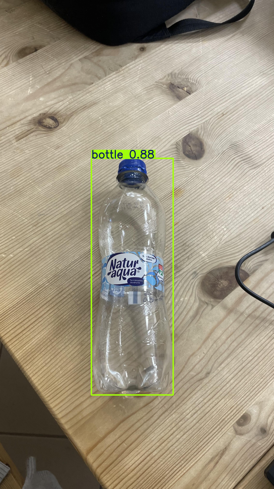
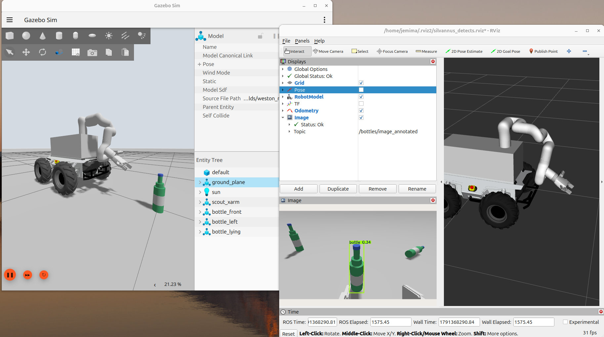

# silvanus_bottle_picker
The robot that pays for itself
------------------------------------
---

## 🗺️ Localization & Mapping

This module manages 2D occupancy grid generation, TF frame transformations, sensor fusion, and real-time relocalization using `slam_toolbox`.

### 📅 Phase 1: Simulation Mapping & Frame Setup (Oct 1 – Oct 14)
- [ ] **URDF & TF Tree Verification**
  - Verify complete TF chain in Gazebo: `map` ➔ `odom` ➔ `base_link` ➔ `laser` / `imu`.
- [ ] **`slam_toolbox` Simulation Configuration**
  - Configure `slam_toolbox` in `async_online` mode mapping incoming 2D LiDAR scans (`/scan`).
  - Tune map resolution (0.05m), maximum laser range, and scan matcher parameters.
- [ ] **Map Persistence Testing**
  - Verify map saving and loading services (`map_saver_cli` / `slam_toolbox` serialized maps).

### 📅 Phase 2: Physical Hardware Bringup on Silvanus Base (Oct 15 – Oct 28)
- [ ] **Sensor Data Integration**
  - Verify live `/scan` and `/imu/data` streams from `scout_ros2` / `ugv_sdk` drivers.
  - Calibrate physical LiDAR placement and update wheel base transformations in URDF.
- [ ] **Campus Mapping Run**
  - Perform mapping runs around the ELTE IK testing grounds to produce baseline 2D maps.

### 📅 Phase 3: Relocalization & Outdoor Robustness (Oct 29 – Nov 30)
- [ ] **Relocalization Mode Setup**
  - Configure `slam_toolbox` for offline localization using pre-built maps.
- [ ] **Wheel-Slip & Terrain Mitigation**
  - Evaluate IMU + wheel odometry drift on grass and uneven terrain using `robot_localization` (EKF).
  - Test map updates when dynamic obstacles (e.g., pedestrians, temporary bins) are present.

---

## 🎯 Planning & Path Following

This module handles high-level target routing, Nav2 path execution, mobile manipulator docking within the xArm6 workspace envelope, and optional RL / Human-Aware local navigation layers.

### 📅 Phase 1: Base Kinematics & Team ROS 2 Interfaces (Oct 1 – Oct 14)
- [ ] **Skid-Steer Motion Control**
  - Validate non-holonomic velocity response (`cmd_vel`) using `ros2_control`.
- [ ] **Interface Definitions (Topic Contracts)**
  - Subscribed: `/trash_target_pose` (`geometry_msgs/PoseStamped`) from Perception.
  - Subscribed: `/arm_execution_status` (`std_msgs/String`) from Arm.
  - Published: `/base_in_position` (`std_msgs/Bool`) to trigger picking/dumping actions.

### 📅 Phase 2: Nav2 Core & Workspace Envelope Docking (Oct 15 – Oct 28)
- [ ] **Nav2 Stack Configuration**
  - Configure **Nav2 MPPI Controller** (Model Predictive Path Integral) tuned for skid-steer outdoor dynamics.
  - Define custom footprint parameters in `nav2_params.yaml` accounting for xArm6 payload clearance.
- [ ] **Terminal Approach & Docking Policy**
  - Build precision approach node positioning the base $0.4\text{ m} - 0.6\text{ m}$ away from detected trash for optimal xArm6 dexterity.
- [ ] **Central Bin Offloading Logic**
  - Implement onboard bin capacity tracker to route the base to the Central Bin when full.

### 📅 Phase 3: System Integration & End-to-End Pipeline (Oct 29 – Nov 4)
- [ ] **End-to-End Autonomous Cycle (Milestone 1)**
  - Validate full loop: *Detect Trash* ➔ *Navigate to Target* ➔ *Trigger Pick* ➔ *Offload to Onboard Bin* ➔ *Route to Central Bin*.
- [ ] **Recovery Behaviors**
  - Configure costmap clearing, backup maneuvers, and obstacle recovery behavior trees.

### 📅 Phase 4: RL & Human-Aware Extension Layer (Nov 5 – Nov 18)
- [ ] **Human-Aware Navigation Integration**
  - *Option A:* Integrate Social Navigation costmap layers for dynamic pedestrian distance halos.
  - *Option B:* Integrate pre-trained RL local planner (ONNX policy inference node via PyTorch / C++ API).
- [ ] **Benchmarking & Evaluation**
  - Compare Standard Nav2 MPPI vs. Human-Aware/RL Layer across path smoothness, clearance distance, and time-to-goal metrics.

### 📅 Phase 5: Outdoor Field Validation & Code Freeze (Nov 19 – Nov 30)
- [ ] **Outdoor Surface Testing**
  - Benchmark motion planning on gravel, grass, and incline paths around campus.
- [ ] **System Launch Consolidation**
  - Build unified bringup launch architecture (`ros2 launch silvanus_navigation system_bringup.launch.py`).
- [ ] **Hard Code Freeze (Nov 30, 23:59)**
  - Final repository cleanup and tagging before documentation phase (Dec 1).

---

## Perception: Bottle Recognition & Approach
**Bottle Recognition & Approach** 

This section documents the iterative development of the vision and approach module for the Silvanus robot.

### Update: [01/10/26] - Environment Setup & First Detections

* **Environment Setup:** Successfully initialized and configured the workspace for the bottle detection algorithms.
* **Initial Model Testing:** Deployed the first approximate model for bottle recognition.

*Caption: Environment detection in gazebo.*

* **Troubleshooting:** Encountered a deployment blocker where the model was `Not working due to a GPU error` (specifically: Problem by setting up with the CUDA environment and unable to run YOLO).
* **Validation:** After resolving the GPU issue, successfully tested the model using random sample images.

#### Detection Results:
*(Below are the initial detection tests after resolving the GPU error)*

*Caption: Additional testing to verify model accuracy on random images.*

### Update: [Current Date] - Detection Positioning & 3D Spatial Integration

We have established and integrated a dedicated configuration file that commands the robotic arm to automatically navigate to a predefined "detection position." After conducting multiple preliminary tests in the simulation, we deliberately selected this specific posture because it currently provides the camera with an optimal, unobstructed field of view of the workspace. This angle significantly enhances the reliability of the bottle recognition algorithm. While this static position serves as our current baseline for approaching the target, it provides a highly stable foundation for our vision system.

In parallel with optimizing the detection posture, we are actively working on introducing 3D position estimation within the Gazebo simulation environment. By mapping the 2D bounding boxes generated by our vision model into 3D spatial coordinates (X, Y, Z), our goal is to allow the system to accurately calculate the bottle's exact physical location relative to the robot. This 3D mapping is a critical prerequisite for the upcoming grasping phase.

*Caption: The selected robotic posture optimized for bottle detection within the simulation.*
